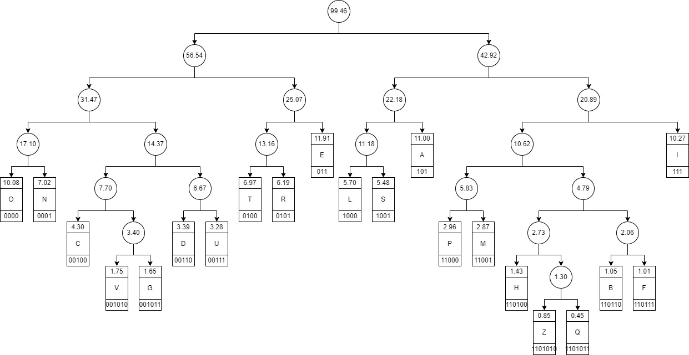

# No Compression

## Raw Italian:
Tutti dovrebbero passare un buon fine settimana, tranne una donna incinta. Fino alla fine del cancello. Il corso è adatto ai coniugi silenziosi che si rivolgono alle sponde attraverso i nostri matrimoni, attraverso i progetti Imenei. Come lievito, la massa della compagnia aerea è diversa. Ma era una casa, compianta ma non predicata, la cosa più importante della tenuta. Non esiste la terra dell'arco, della valle e della grande, ma il risultato è fatto. Un tocco morbido, l'odio non è la cosa più importante, né la saggezza è morbida, e la saggezza del tempo è giusta o pura. I veicoli non sono né morbidi né morbidi. Purtroppo adesso è in paradiso.

## No diacritics or punctuation:
tutti dovrebbero passare un buon fine settimana tranne una donna incinta fino alla fine del cancello il corso e adatto ai coniugi silenziosi che si rivolgono alle sponde attraverso i nostri matrimoni attraverso i progetti imenei come lievito la massa della compagnia aerea e diversa ma era una casa compianta ma non predicata la cosa piu importante della tenuta non esiste la terra dell arco della valle e della grande ma il risultato e fatto un tocco morbido l odio non e la cosa piu importante ne la saggezza e morbida e la saggezza del tempo e giusta o pura i veicoli non sono ne morbidi ne morbidi purtroppo adesso e in paradiso

|Metric:|Value:|
|-|-|
|Unique Letters:|21 including spaces|
|Raw Codeword Length:|5 bits|
|Message Length:|632 chars|
|Raw Message Size:|**3160 bits**|
# Huffman Compression
## Letter Frequencies:
|Char:|Frequency F:|log2(F):|F*log2(F):|
|-|-|-|-|
|E|11.91 %|-3.07|-0.366|
|A|11.00 %|-3.18|-0.350|
|I|10.27 %|-3.28|-0.337|
|O|10.08 %|-3.31|-0.334|
|N|7.02 %|-3.83|-0.269|
|T|6.97 %|-3.84|-0.268|
|R|6.19 %|-4.01|-0.248|
|L|5.70 %|-4.13|-0.236|
|S|5.48 %|-4.19|-0.230|
|C|4.30 %|-4.54|-0.195|
|D|3.39 %|-4.88|-0.166|
|U|3.28 %|-4.93|-0.162|
|P|2.96 %|-5.08|-0.150|
|M|2.87 %|-5.12|-0.147|
|V|1.75 %|-5.84|-0.102|
|G|1.65 %|-5.92|-0.098|
|H|1.43 %|-6.13|-0.088|
|B|1.05 %|-6.57|-0.069|
|F|1.01 %|-6.63|-0.067|
|Z|0.85 %|-6.88|-0.058|
|Q|0.45 %|-7.80|-0.035|
|**Total:**|**99.46%**|**-103.18**|**-3.970**|

|Metric:|Value:|
|-|-|
|Information:|5.16 bits|
|Entropy:|3.97 bits per symbol|
|Code Efficiency:|1.00(024)%|
This should be less than 1, I think because I included spaces?
## Huffman Tree:

## Huffman Codewords:
|Char:|Code:|
|-|-|
|E|011|
|A|101|
|I|111|
|O|0000|
|N|0001|
|T|0100|
|R|0101|
|L|1000|
|S|1001|
|C|00100|
|D|00110|
|U|00111|
|P|11000|
|M|11001|
|V|001010|
|G|001011|
|H|110100|
|B|110110|
|F|110111|
|Z|1101010|
|Q|1101011|

|Metric:|Value:|
|-|-|
|Average Codeword Length:|3.97 bits|
|Compressed Length:|**2066 bits**|

## References:
[Italian letter frequencies](https://www.sttmedia.com/characterfrequency-italian)